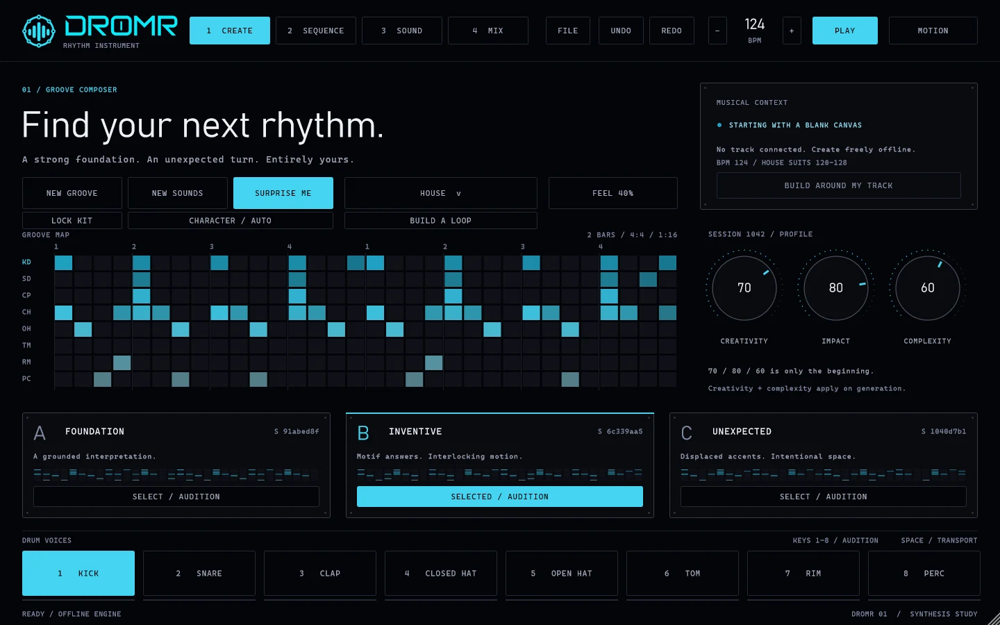

# DROMR

**A rhythm instrument that builds grooves lane by lane.** A drum instrument that builds grooves the way a drummer plays them: kick first, then a snare that fits it, then hats that answer, then the extras.

### [Open the page](https://jesaias1.github.io/DROMR/) &nbsp;|&nbsp; [Download the early preview](https://github.com/jesaias1/DROMR/releases/latest)

**12** styles, each with its own rules / **8** drum lanes on standard MIDI notes / **3** alternatives for every groove / **0** samples: every voice is synthesized

## What it does

- **Built in the order a drummer thinks.** Kick, then snare or clap fitted to it, then closed hat, open hat, and finally tom, rim and percussion. Each lane sees what is already there.
- **Twelve styles with real rules.** Boom bap, trap, indie rock, jazz, funk, house, UK garage, jungle, cinematic, experimental, ambient and acoustic pop, each with its own backbeat, swing and rests.
- **Build a loop, stage by stage.** Press KICK, audition four proposals, keep one, then get a snare fitted to it. Hats and extras follow. Re-roll any stage without losing the earlier ones.
- **Two-bar phrases.** Bar 2 is a variation of bar 1: an anticipated kick, a changed ending, a ghost note or a short fill.
- **Locks that mean it.** Lock any lane and it survives every generation, every re-roll and every style change.
- **Honest timing.** Swing belongs to the style. FEEL adds only small timing and velocity drift. Every hit sits at its real 960-ticks-per-beat position.
- **Eight synthesized voices.** Kick, snare, clap, closed and open hat, tom, rim and perc, with a kick forge and acoustic membrane models. Standard MIDI notes.
- **Follows your DAW.** In a plugin host the tempo comes from the host, and DROMR shows which BPM range each style was written for.

## Requirements

- Windows 10 or 11, 64-bit
- A DAW that loads VST3 instruments (for the plugin)
- The standalone app needs only an audio device
- No sample library required

## Closed source

This repository holds the product page and download links only. The source code is not published.
&copy; 2026 Linas Jesaias. All rights reserved. See [LICENSE](LICENSE). The early-preview binaries may be downloaded and used to evaluate the software.
